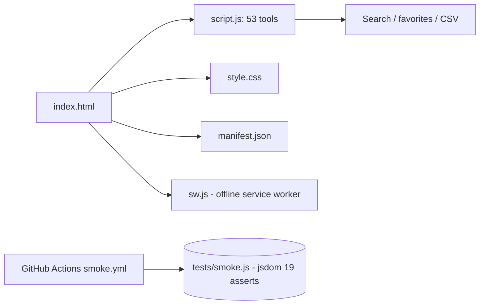

# KODAROS Tools

**English** · [Português (Brasil)](README.md)

[](#) [](#) [](#.github/workflows/smoke.yml) [](LICENSE)

## What it is

A set of **53 business calculators and generators** that run entirely in the browser, with no server and no AI. They cover acquisition, launch, finance, sales, support and content — and are used from the KODAROS digital-products site.

It is an **offline-first PWA**: a service worker caches the core files and the app keeps working with no network.

## Status

In production. Published at <https://kelvinoliveiracode.github.io/kodaros-ferramentas/> (HTTP 200 verified; GitHub Pages `built`, HTTPS enforced).

## Features

- **53 tools** grouped by category (see Structure/Stack). Examples: CAC vs LTV calculator, profit margin, break-even point, compound interest, paid-traffic ROI (ROAS), ad-copy generator, launch schedule, on-page SEO checklist, Instagram post template, UTM builder.
- **100% client-side**: nothing is sent to a server; calculation and rendering run in JavaScript in the browser.
- **Search** with real-time filtering and a clear button.
- **Favorites** persisted (toggleable favorite chip).
- **Copyable results** and **CSV export** for some results.
- **Offline-first**: a service worker (`sw.js`, cache `kodaros-tools-v5`) precaches the core files.

## Architecture

Two application files — `index.html` (structure) and `script.js` (logic for the 53 tools) — plus `style.css` for the theme. A `sw.js` registers the service worker. A smoke test runs with **jsdom** in CI (GitHub Actions).



## Stack

- HTML5 + CSS3
- JavaScript ES6+ (`script.js`, 1845 lines)
- PWA: `manifest.json` + `sw.js` (service worker, cache v5)
- Tests: jsdom ^29.1.1 (Node, no framework)
- CI: GitHub Actions, Node 20

## Repository layout

```
kodaros-ferramentas/
├── index.html        # structure for the 53 tools
├── script.js         # tool logic (1,845 lines)
├── style.css         # theme and layout (305 lines)
├── sw.js             # offline-first service worker (cache v5)
├── manifest.json     # PWA manifest
├── tests/
│   ├── smoke.js      # smoke test (jsdom), 19 asserts
│   └── package.json  # devDependency: jsdom
├── .github/workflows/smoke.yml  # CI on push/PR to main
├── robots.txt · sitemap.xml
└── LICENSE           # MIT
```

## Prerequisites and installation

None to use it: it is a static site. For development and contributions, only Node.js (tested on v20) and the package manager inside `tests`.

## How to run

```bash
# serve locally
python -m http.server 8080
# go to http://localhost:8080
```

## Tests and quality

- Command: `cd tests && npm install && npm run test` (runs `node smoke.js` with jsdom).
- Real result (verified by the agent): **19 asserts passing** — covering CAC calculation sensitivity (3 scenarios), markup pricing, margin, a 6-month cash-flow projection, CSV export error-free, the empty-search state, the favorite chip, and no runtime errors. Final output: "Tudo ok."
- CI: the `smoke.yml` workflow runs on push and on pull requests to `main` (Node 20).

## Technical decisions and trade-offs

- **Zero runtime dependencies and zero backend**: each tool is self-contained in the browser, guaranteeing privacy and minimal hosting cost, at the expense of no server-side persistence.
- **Offline-first via service worker**: makes "works without internet" a selling point of the app.
- **A single 1,845-line `script.js`** instead of modules: simpler deployment, in exchange for a large, coupled file.

## Known limitations and roadmap

- Results are not saved to a server (no account or sync).
- Favorites and CSV stay in the browser (your user's localStorage).
- No backend I/O: integrations with spreadsheets or CRMs depend on the user.

## Development process

An individual project by Kelvin Oliveira, built with orchestrated AI agents and reviewed by the author. The curation of the 53 tools, the offline-first architecture and the maintenance are the author's.

## License and author

MIT — Copyright (c) 2026 Kelvin Rebelo de Oliveira.

**Author**: [Kelvin Oliveira](https://github.com/KelvinOliveiraCode) · [Portfolio](https://kelvinoliveiracode.github.io/portfolio/)
