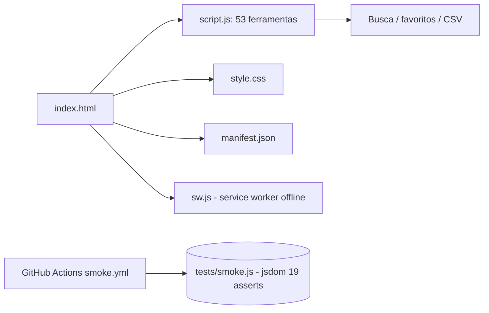

# Ferramentas KODAROS

[English](README.en.md) · **Português (Brasil)**

[](#) [](#) [](#.github/workflows/smoke.yml) [](LICENSE)

## O que é

Conjunto de **53 calculadoras e geradores de negócio** que rodam 100% no navegador, sem servidor e sem IA. São ferramentas para aquisição, lançamento, financeiro, vendas, suporte e conteúdo — usadas a partir do site de produtos digitais da KODAROS.

É um PWA **offline-first**: um service worker cacheia os arquivos principais e o app segue funcionando sem rede.

## Status

Em produção. Publicado em <https://kelvinoliveiracode.github.io/kodaros-ferramentas/> (HTTP 200 verificado, GitHub Pages `built`, HTTPS forçado).

## Funcionalidades

- **53 ferramentas** organizadas em categorias (ver Estrutura/Stack). Exemplos: calculadora CAC vs LTV, margem de lucro, ponto de equilíbrio, juros compostos, ROI de tráfego (ROAS), gerador de ad copy, cronograma de lançamento, checklist SEO on-page, template de post para Instagram, UTM builder.
- **100% client-side**: nada é enviado a servidor; cálculo e renderização rodam em JavaScript no navegador.
- **Busca** com filtragem em tempo real e botão de limpar.
- **Favoritos** persistidos (chip de favorito ativável).
- **Resultados copiáveis** e exportação de alguns resultados em **CSV**.
- **Offline-first**: service worker (`sw.js`, cache `kodaros-tools-v5`) faz precache dos arquivos principais.

## Arquitetura

Dois arquivos de aplicação — `index.html` (estrutura) e `script.js` (lógica das 53 ferramentas) — com `style.css` para o tema. Um `sw.js` registra o service worker. Teste de fumaça roda com **jsdom** em CI (GitHub Actions).



## Stack

- HTML5 + CSS3
- JavaScript ES6+ (`script.js`, 1845 linhas)
- PWA: `manifest.json` + `sw.js` (service worker, cache v5)
- Testes: jsdom ^29.1.1 (Node, sem framework)
- CI: GitHub Actions, Node 20

## Estrutura do repositório

```
kodaros-ferramentas/
├── index.html        # estrutura das 53 ferramentas
├── script.js         # lógica das ferramentas (1.845 linhas)
├── style.css         # tema e layout (305 linhas)
├── sw.js             # service worker offline-first (cache v5)
├── manifest.json     # manifesto PWA
├── tests/
│   ├── smoke.js      # smoke test (jsdom), 19 asserts
│   └── package.json  # devDependency: jsdom
├── .github/workflows/smoke.yml  # CI no push/PR para main
├── robots.txt · sitemap.xml
└── LICENSE           # MIT
```

## Pré-requisitos e instalação

Nenhum para usar: é um site estático. Para dev/contribuição, apenas Node.js (testado na v20) e o gerenciador de pacotes da pasta `tests`.

## Como executar

```bash
# servir localmente
python -m http.server 8080
# acesse http://localhost:8080
```

## Testes e qualidade

- Comando: `cd tests && npm install && npm run test` (roda `node smoke.js` com jsdom).
- Resultado real (verificado pelo agente): **19 asserts passando** — inclui sensibilidade do cálculo de CAC (3 cenários), precificação com markup, margem, projeção de fluxo em 6 meses, exportação CSV sem erro, estado vazio da busca, favorito com chip e ausência de erros de runtime. Saída final: "Tudo ok."
- CI: fluxo `smoke.yml` roda no push e em pull request para `main` (Node 20).

## Decisões técnicas e trade-offs

- **Zero dependências de runtime e zero backend**: cada ferramenta é autônoma no navegador; garantia de privacidade e custo de hospedagem mínimo, ao custo de nenhuma persistência servidor-side.
- **Offline-first via service worker**: permite vender "funciona sem internet" como diferencial do app.
- **Um único `script.js` com 1845 linhas** em vez de módulos: simplicidade de deploy, em troca de arquivo grande e acoplamento.

## Limitações conhecidas e roadmap

- Os resultados não são salvos em servidor (não há conta nem sincronização).
- Os favoritos e o CSV ficam no navegador (localStorage) do usuário.
- Sem IO de backend: integrações com planilhas/CRM dependem do usuário.

## Processo de desenvolvimento

Projeto individual de Kelvin Oliveira, construído com agentes de IA orquestrados e revisado pelo autor. A curadoria das 53 ferramentas, a arquitetura offline-first e a manutenção são do autor.

## Licença e autor

MIT — Copyright (c) 2026 Kelvin Rebelo de Oliveira.

**Autor**: [Kelvin Oliveira](https://github.com/KelvinOliveiraCode) · [Portfólio](https://kelvinoliveiracode.github.io/portfolio/)
